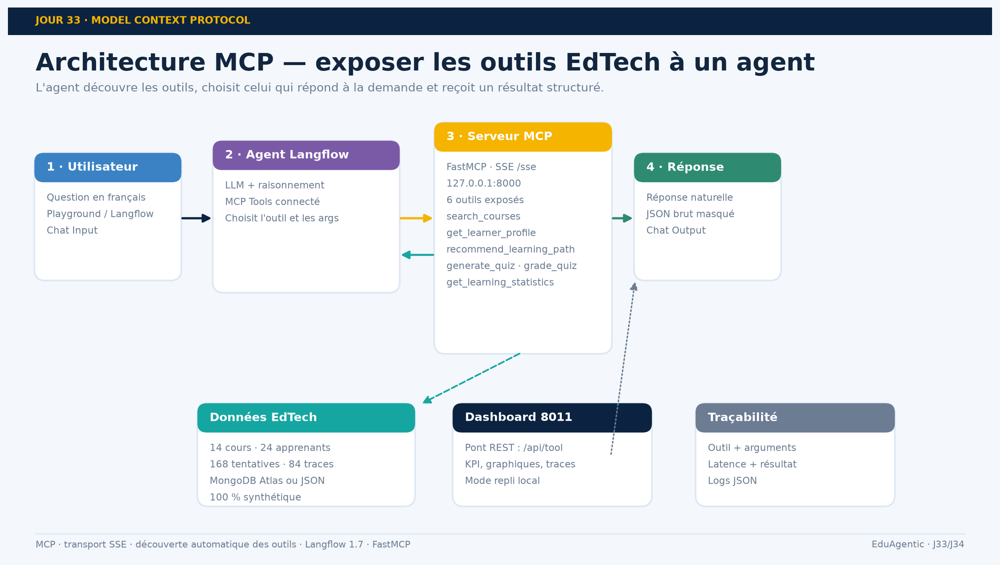
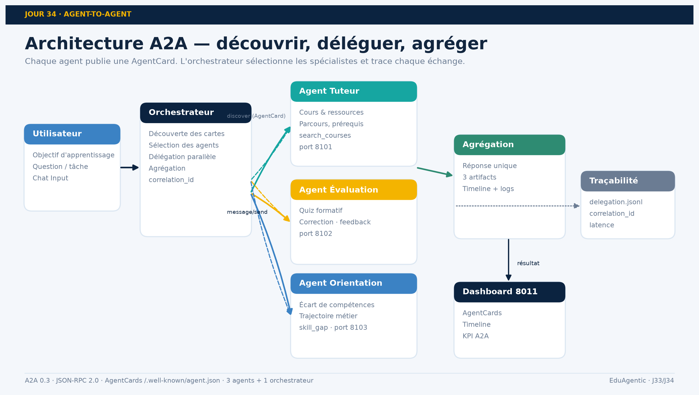

# EduAgentic · Agentic AI in Education Technology


**Mini-projets Jours 33 & 34 — MCP et A2A — correction finale**

Un serveur **MCP** qui expose six outils EdTech, un système multi-agents **A2A** qui découvre et délègue, et un dashboard **Streamlit** sur `localhost:8011` pour tout observer.

| | |
|---|---|
| **Auteur** | Kamal El Afoui |
| **Programme** | Centre des Très Petites Entreprises Solidaires · DBA Technology |
| **Date** | 11 novembre 2026 |
| **Version** | 1.0.0 — correction finale |
| **Données** | 100 % synthétiques · 0 apprenant réel |

---

## 1. Démo en 3 commandes

```powershell
# 1. Dépendances
python -m pip install -r requirements.txt

# 2. MCP + 3 agents A2A + orchestrateur + dashboard
python a2a/run_all.py --with-dashboard

# 3. Ouvrir
#    Dashboard : http://localhost:8011
#    MCP SSE   : http://127.0.0.1:8000/sse
#    A2A       : http://127.0.0.1:8001
```

Sans serveur, le dashboard bascule automatiquement sur le moteur local et l'indique dans la trace.

### Lancement séparé

```powershell
# Terminal 1 — serveur MCP
python mcp_server/edumcp_server.py

# Terminal 2 — agents A2A + orchestrateur
python a2a/run_all.py

# Terminal 3 — dashboard
streamlit run dashboard/app.py --server.port 8011
```

Sous Windows, `start_demo.ps1` fait la même chose.

---

## 2. Architecture

### Jour 33 · MCP



- **Serveur** : FastMCP, transport **SSE**, `127.0.0.1:8000`.
- **6 outils** : `search_courses`, `get_learner_profile`, `recommend_learning_path`, `generate_quiz`, `grade_quiz`, `get_learning_statistics`.
- **Workflow Langflow** : `Chat Input → Agent → MCP Tools → Chat Output`.
- **JSON final** : [`json/Agentic_AI_EdTech_J33_MCP_Final.json`](json/Agentic_AI_EdTech_J33_MCP_Final.json).

### Jour 34 · A2A



- **Orchestrateur** : `127.0.0.1:8001` — découvre, sélectionne, délègue, agrège.
- **Agent Tuteur** : `8101` — cours, ressources, parcours.
- **Agent Évaluation** : `8102` — quiz, correction, feedback.
- **Agent Orientation** : `8103` — écart de compétences, trajectoire métier.
- **AgentCards** : `/.well-known/agent.json`.
- **Protocole** : JSON-RPC 2.0 (`message/send`, `tasks/get`) + `correlation_id`.
- **JSON final** : [`json/Agentic_AI_EdTech_J34_A2A_Final.json`](json/Agentic_AI_EdTech_J34_A2A_Final.json).

### Dashboard

| Page | Contenu |
|---|---|
| Vue d'ensemble | KPI, cartes J33/J34, activité récente |
| MCP Playground | formulaire, réponse, trace outil → arguments → latence → résultat |
| A2A Orchestration | AgentCards, formulaire, timeline, artifacts, logs |
| Statistiques | 6 graphiques filtrables, export CSV |
| Documentation | téléchargement des livrables |
| Architecture | schémas et comparatif MCP / A2A |

---

## 3. Données

Le projet fonctionne avec deux backends interchangeables :

1. **JSON/CSV locaux** (par défaut sans `.env`) : `data/*.json`, `data/*.csv`.
2. **MongoDB Atlas** (optionnel) : collections `edtech_courses`, `edtech_learners`, `edtech_quiz_bank`, `edtech_quiz_attempts`, `edtech_a2a_delegations`.

Pour activer Atlas :

```powershell
Copy-Item .env.example .env
# éditer .env et renseigner MONGODB_URI
```

> ⚠️ **Sécurité** : `.env` est ignoré par Git. Ne jamais committer l'URI, ne jamais la mettre dans un document ou une capture. Le dépôt ne contient que `.env.example`. En cas de fuite, révoquer l'utilisateur Atlas et régénérer le mot de passe.

Les collections existantes de la base ne sont **jamais** modifiées : le projet utilise uniquement le préfixe `edtech_`.

Volume synthétique : **14 cours**, **24 apprenants**, **30 questions**, **168 tentatives**, **84 traces A2A**.

---

## 4. Livrables

| Livrable | Fichier |
|---|---|
| Documentation J33 | `docs/Documentation_J33_MCP_EdTech.docx` / `.pdf` |
| Documentation J34 | `docs/Documentation_J34_A2A_EdTech.docx` / `.pdf` |
| Documentation globale | `docs/Documentation_Globale_J33_J34.docx` / `.pdf` |
| Présentation J33 | `presentation/J33_MCP_Presentation.pptx` / `.pdf` |
| Présentation J34 | `presentation/J34_A2A_Presentation.pptx` / `.pdf` |
| Présentation finale | `presentation/Presentation_Finale_J33_J34.pptx` / `.pdf` |
| Workflows Langflow | `json/Agentic_AI_EdTech_J33_MCP_Final.json`, `json/Agentic_AI_EdTech_J34_A2A_Final.json` |
| AgentCards | `json/agent_cards/*.json`, `json/a2a_registry.json` |
| Vidéo MCP | `videos/J33_MCP_Workflow_Playground.mp4` |
| Vidéo A2A | `videos/J34_A2A_Workflow_Playground.mp4` |
| Vidéo finale | `videos/Video_Finale_Agentic_AI_EdTech.mp4` |
| Archive | `Agentic_AI_EdTech_J33_J34_FINAL.zip` |

Checklist détaillée : [`LIVRABLES.md`](LIVRABLES.md). Publication GitHub : [`GITHUB.md`](GITHUB.md).

---

## 5. Tests rapides

```powershell
# Santé MCP + backend
curl http://127.0.0.1:8000/api/health

# Découverte A2A
curl http://127.0.0.1:8001/discover

# Orchestration A2A
curl -X POST http://127.0.0.1:8001/orchestrate `
  -H "Content-Type: application/json" `
  -d '{"learner_id":"L001","objective":"Devenir Data Analyst","question":"Parcours, ressources et quiz"}'
```

Résultats mesurés le 11/11/2026 : **6/6 outils**, **3/3 agents**, **0 exception dashboard**, latence locale de l'ordre de quelques dizaines de millisecondes.

---

## 6. Arborescence

```text
Agentic_AI_EdTech_J33_J34/
├── assets/               # logo, schémas, visuels
├── a2a/                  # agents, orchestrateur, protocole, AgentCards
├── dashboard/            # application Streamlit (port 8011)
├── data/                 # données synthétiques + benchmarks
├── docs/                 # documentation DOCX/PDF
├── json/                 # workflows Langflow + registre A2A
├── mcp_server/           # serveur FastMCP (port 8000)
├── presentation/         # présentations PPTX/PDF
├── scripts/              # génération données/docs/decks/vidéos/JSON
├── shared/               # moteur métier + backend MongoDB
├── videos/               # vidéos MP4
├── .env.example
├── requirements.txt
└── README.md
```

---

## 7. Stack

- **MCP** : SDK Python officiel `mcp`, FastMCP, SSE.
- **A2A** : FastAPI, JSON-RPC 2.0, AgentCards, `correlation_id`.
- **Dashboard** : Streamlit, Plotly, Pandas.
- **Données** : JSON/CSV + MongoDB Atlas optionnel (pymongo).
- **Livrables** : python-docx, python-pptx, Word/PowerPoint COM, ffmpeg, Edge TTS.

## 8. Licence et données

Code sous licence MIT. Les données sont entièrement synthétiques et ne représentent aucune personne réelle. Voir [`LICENSE`](LICENSE).
